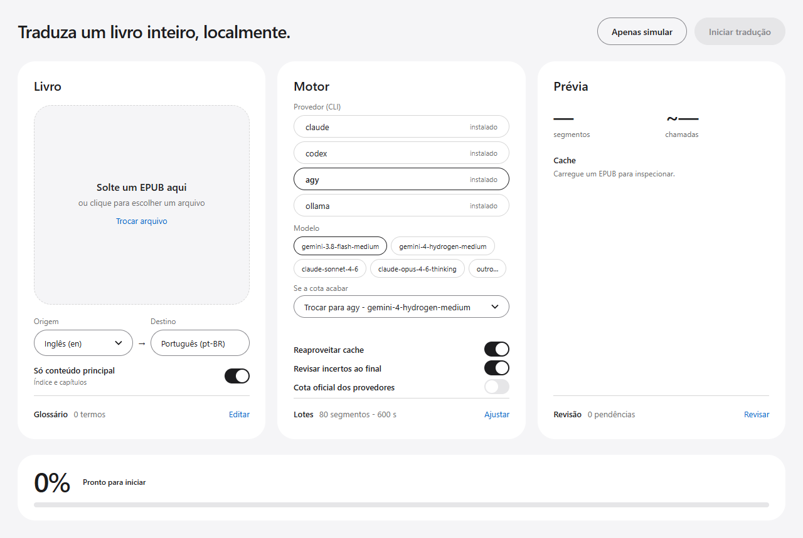
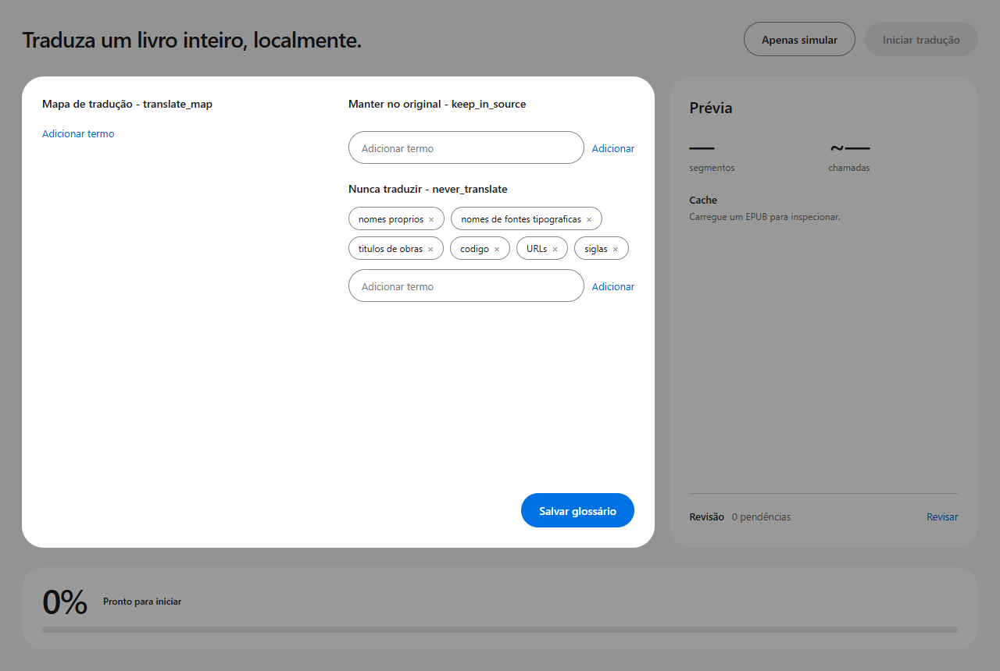
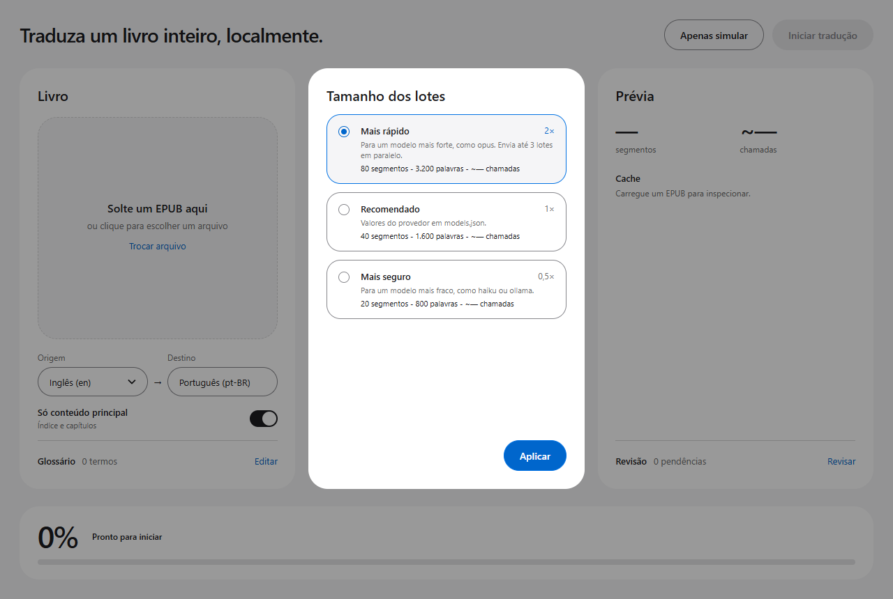
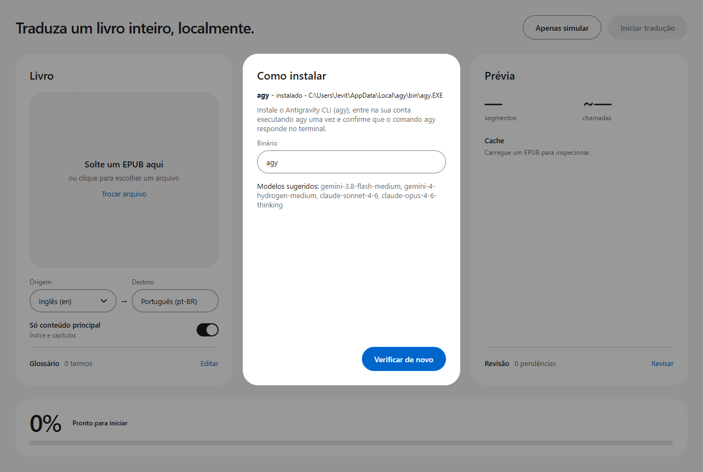
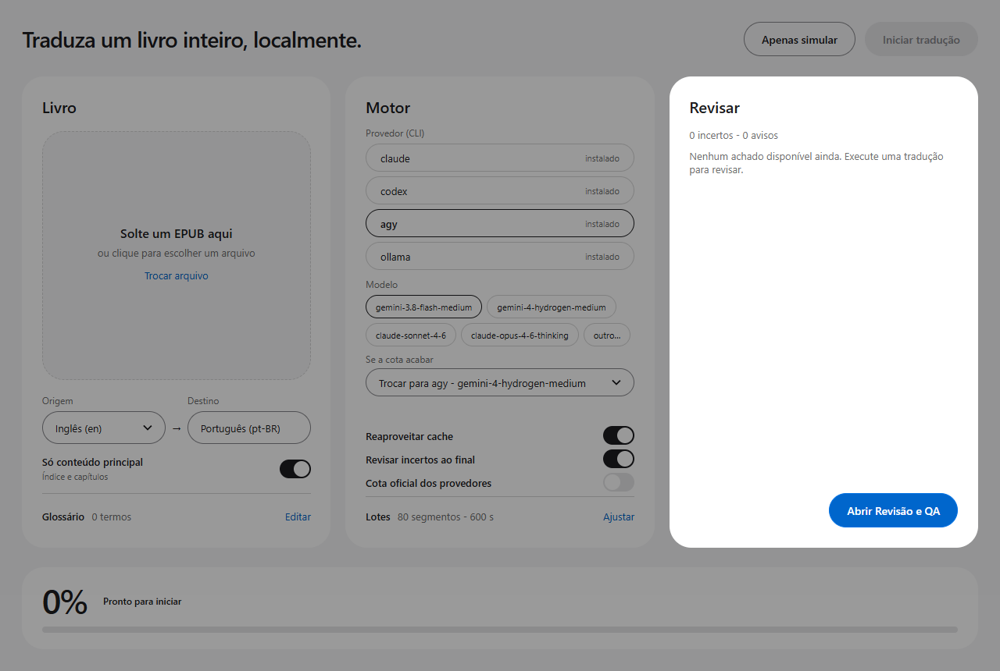

# Lector (`v0.3.0`)

Tradutor local de livros EPUB para português (`pt-BR`) com interface web e assistente de terminal, usando CLIs de IA instalados no seu computador.
---

## O que este programa faz

- Lê um arquivo `.epub`, extrai os textos traduzíveis substituindo tags inline por marcadores opacos (`⟦n⟧…⟦/n⟧`) e preserva estrutura, imagens, estilos e metadados.
- Traduz os segmentos em lotes usando o CLI local que você escolher (`claude`, `codex`, `agy` ou `ollama`).
- Executa verificação pós-tradução (glossário, termos preservados, números) e portões estruturais de QA antes de empacotar o `.epub` final e gerar o relatório `.report.md`.
- Mantém um cache SQLite compartilhado (`cache/lector.tmcache`) para retomar interrupções sem repetir trabalho e reaproveitar traduções entre livros e modelos.

---

## Requisitos e instalação

### Pré-requisitos

- **Sistema operacional:** Windows 10 ou 11 (suporta caminhos longos acima de 255 caracteres).
- **Python:** 3.11 ou superior disponível no `PATH` (marque *Add Python to PATH* no instalador).
- **Pelo menos um CLI suportado instalado e autenticado:**
  - `claude` (Claude Code — `npm install -g @anthropic-ai/claude-code`)
  - `codex` (Codex CLI — `npm install -g @openai/codex`)
  - `agy` (Antigravity CLI)
  - `ollama` (modelos locais via `ollama.com` + `ollama pull <modelo>`)
- Conexão com a internet durante a instalação das dependências Python.

### Instalação

Execute **`instalar.bat`** na pasta do projeto. Ele verifica o Python (`>= 3.11`), lista os CLIs encontrados no `PATH`, cria o ambiente virtual `.venv` e instala o pacote com dependências de execução e teste (`pip install -e ".[dev]"`).

---

## Como executar

### 1. Interface web local (Lector)

Dê um duplo clique em **`lector.bat`** ou rode manualmente no terminal:

```powershell
.venv\Scripts\python.exe -m epub_translate.web
```

Opções úteis de linha de comando para o servidor web:

```powershell
.venv\Scripts\python.exe -m epub_translate.web --no-browser --port 8788
```

- Endereço padrão: `http://127.0.0.1:8788` (aceita `--host` e `--port`).
- Se você recarregar a página durante uma tradução, a interface se reconecta automaticamente ao job em andamento.

### 2. Assistente interativo e CLI no terminal

Arraste um `.epub` para **`traduzir.bat`** para abrir o wizard interativo no terminal (navegação por setas com `questionary` e barras de progresso `rich`).

Para rodar direto pela linha de comando (sem wizard):

```powershell
.venv\Scripts\python.exe -m epub_translate.cli livro.epub --provider codex --model gpt-5-codex --to pt-BR
.venv\Scripts\python.exe -m epub_translate.cli livro.epub --provider claude --model sonnet --reuse-cache
.venv\Scripts\python.exe -m epub_translate.cli livro.epub --engine pseudo --to pt-BR --dry-run
```

Principais flags do CLI:

- `--provider {claude,codex,agy,ollama,identity,pseudo}` (`--engine` continua aceito por compatibilidade)
- `--model <nome>`
- `--from <idioma>` / `--to <idioma>` (padrão `pt-BR`)
- `--glossary <caminho.json>`
- `--reuse-cache` (no CLI vem desligado por padrão; na interface web vem ligado por padrão)
- `--no-cache` (não lê nem grava `.tmcache`)
- `--only <arquivo>` (traduz apenas um documento do EPUB, útil para depuração)
- `--dry-run` (analisa e estima chamadas sem acionar o motor)

---

## Tour pela interface web

A tela principal concentra todo o fluxo em **3 colunas** (`Livro`, `Motor`, `Prévia`), cabeçalho com **`Apenas simular`** / **`Iniciar tradução`** e uma **barra de status inferior** com painéis detalhados sob demanda:

1. **Card `Livro`:**
   - Área para soltar ou escolher um `.epub` (envio armazenado em `cache/livros/` e inspecionado localmente sem chamar IA).
   - **Idiomas (`Origem → Destino`):** o destino é fixo em **Português (`pt-BR`)** na interface web. A origem oferece **Inglês (`en`)**, **Chinês (`zh`)** e o idioma detectado automaticamente nos metadados do livro (OPF).
   - **`Só conteúdo principal` (ligado por padrão):** traduz o índice (`nav`/`ncx`) e os capítulos principais, preservando arquivos auxiliares (capa, folha de rosto, copyright, dedicatória, colofão, glossário, bibliografia, índice remissivo) no idioma original.
   - **Rodapé `Glossário` → `Editar`:** abre o editor visual para `translate_map` (pares termo original → tradução fixa), `keep_in_source` (manter no original) e `never_translate` (categorias que não devem ser traduzidas).

2. **Card `Motor`:**
   - **Provedor (CLI):** lista `claude`, `codex`, `agy` e `ollama` com status em tempo real (`instalado`, consumo recente registrado pelo Lector nas últimas 5 h, ou `não encontrado` com link **`Como instalar`** para informar o caminho completo do executável em `models.json`). Provedores com cota esgotada exibem borda laranja e contagem regressiva quando informada.
   - **Modelo:** pílulas de modelos sugeridos de `models.json` mais **`outro…`** para digitar qualquer nome de modelo suportado pelo CLI.
   - **`Reaproveitar cache` (ligado por padrão):** reaproveita segmentos compatíveis já traduzidos por outros modelos/provedores reais (exceto `pseudo` e `identity`).
   - **`Revisar incertos ao final` (ligado por padrão):** envia trechos suspeitos (até 300 segmentos) para uma segunda passada de revisão pelo modelo ao fim dos lotes.
   - **`Cota oficial dos provedores` (desligado por padrão):** consulta a porcentagem oficial de uso e horário de reset para `claude` e `codex` (veja os avisos em [Cache e cota](#cache-e-cota)).
   - **`Se a cota acabar`:** seleciona um provedor/modelo reserva para troca automática caso a cota do principal se esgote no meio do livro.
   - **Rodapé `Lotes` → `Ajustar`:** escolhe entre três presets aplicados sobre os limites base de `models.json`:
     - **`Mais rápido` (`2×`):** lotes maiores e até 3 lotes em paralelo (`ollama` é limitado a 1 worker em `models.json`).
     - **`Recomendado` (`1×`):** valores padrão do provedor.
     - **`Mais seguro` (`0,5×`):** lotes menores, indicado para modelos locais ou mais leves.

3. **Card `Prévia`:**
   - Mostra quantidade de **segmentos**, **chamadas estimadas** e **acertos em cache** (exatos e pendentes) atualizados em tempo real ao mudar livro, modelo, preset ou opções.
   - Botão **`Apenas simular`** no topo abre o resumo detalhado da estimativa sem gastar cota.
   - **Rodapé `Revisão` → `Revisar`:** resume pendências (`X incertos - Y avisos`) e abre a tela completa de **Achados de QA** e **Revisão de segmentos** lado a lado (`Original` × `Tradução`, filtros `incertos`, `avisos`, `todos`), além de **`Salvar cópia…`**, **`Abrir pasta`** e **`Ver todos no relatório`**.

4. **Barra de status inferior e overlays operacionais:**
   - **Estados:** ocioso (`Pronto para iniciar`), **`Em andamento`** (percentual, ETA em minutos, `atualizado há X s` e botão `Cancelar`), **`Interrompida`** (com botão `Retomar`), **`Concluído`** (com botão `Abrir local do arquivo`) ou erro / `QA bloqueou`.
   - Clicar na barra de status abre o painel **`Capítulos`**, com progresso individual: barra azul (na fila / traduzindo / parcial), verde (concluído) e vermelha com botão **`Retraduzir`** (envia ao modelo apenas os segmentos que falharam naquele capítulo; todo o restante vem do cache).
   - Se a cota acabar (sem reserva configurada) ou o motor falhar em 2 lotes consecutivos (**`Motor indisponível`**), um modal pausa a execução mantendo todo o progresso salvo e permite escolher outro provedor/modelo para continuar.

---

## Configurações e arquivos do projeto

| Arquivo / Pasta | Função |
|---|---|
| `models.json` | Catálogo editável de provedores (`binary`, `models`, `batch_segments`, `batch_words`, `timeout`, `max_workers` opcional). |
| `preferences.json` | Últimas escolhas salvas na tela web/CLI (provedor, modelo, preset, cache, reserva, revisão, cota oficial). |
| `glossary.json` | Regras de tradução em UTF-8 (`translate_map`, `keep_in_source`, `never_translate`, `tone`, `main_content_only`). |
| `last_job.json` | Estado do último job para retomada após parada, cota esgotada ou reinício do servidor. |
| `cache/lector.tmcache` | Banco SQLite compartilhado entre livros e modelos (memória de tradução). |
| `cache/livros/` | Cópias dos EPUBs enviados pela tela web (`<nome>-<hash>.epub`). |
| `cache/usage.jsonl` | Medidor local de chamadas, tokens e custo estimados a partir da saída dos CLIs. |
| `saida/` | EPUBs traduzidos e relatórios `.report.md` gerados para livros enviados pela tela web. |

> [!TIP]
> Ao usar o CLI (`traduzir.bat` / `epub_translate.cli`), o `.pt-BR.epub`, o `.report.md`, o `.report.json` e o `.tmcache` são gravados ao lado do arquivo EPUB de entrada (salvo quando `--out`, `--report` ou `--cache` forem informados). Na interface web, livros enviados por upload saem em `saida/`.

### Editar `glossary.json` manualmente

Se preferir editar fora da interface web, salve `glossary.json` em UTF-8 mantendo a estrutura JSON válida:

- `translate_map`: pares `"termo original": "tradução fixa"`.
- `keep_in_source`: lista de termos que devem permanecer no idioma original.
- `never_translate`: lista de categorias a não traduzir (ex.: nomes próprios, código, URLs, siglas).
- `tone`: instrução de tom enviada no prompt do sistema (preservada ao salvar pela UI).
- `note`: anotação livre sua; não altera a tradução.

*(Arquivos YAML antigos não são aceitos nesta versão.)*

---

## Cache e cota

- O cache de traduções fica em `cache/lector.tmcache` (pasta do projeto), compartilhado entre livros e modelos, em modo SQLite WAL (`cache/lector.tmcache-wal` e `-shm` ao lado do arquivo são normais enquanto o servidor roda).
- **Deduplicação e lotes:** textos idênticos dentro do mesmo livro são enviados ao modelo uma única vez e copiados para todas as ocorrências; caudas pequenas de capítulos são agrupadas para reduzir chamadas ao CLI.
- **`Reaproveitar cache`** vem ligado na interface web: reaproveita traduções já feitas mesmo com outro modelo/provedor (traduções dos motores de teste `pseudo` e `identity` nunca são reaproveitadas).
- **Cota e motor reserva:** se a cota do provedor acabar, a tradução para sem perder o que já foi salvo no cache, a tela avisa e pede para escolher outro modelo. Quando **`Se a cota acabar`** está configurado com um reserva no card Motor, o Lector troca automaticamente durante o job — e ao clicar em **`Retomar`**, se o tempo de reset do principal ainda não tiver passado, inicia direto no reserva.
- **Disjuntor (`Motor indisponível`):** se 2 lotes seguidos falharem completamente após as tentativas de retry (backoff de 5 s e 25 s, ou 2 s para erro de modelo não reconhecido), o Lector interrompe o job sem marcar os segmentos como `error`, permitindo retomar ou trocar de motor.
- **Medidor local (`cache/usage.jsonl`):** registra tokens e tempo por chamada (janelas de 5 h, 24 h e 7 dias; podado para manter os últimos 7 dias quando ultrapassa ~1 MB). Não representa a cota oficial da sua assinatura.
- **Cota oficial dos provedores (`Cota oficial dos provedores`):** é opcional e vem **desligada por padrão**. Quando ligada, lê **somente** o token de acesso do login que você já fez nos CLIs `claude` (`~/.claude/.credentials.json`) ou `codex` (`~/.codex/auth.json`), sem gravar ou renovar credenciais e sem registrar tokens em log, para consultar os endpoints internos de uso (`claude` e `codex`). O `agy` guarda o login no cofre seguro do sistema operacional, portanto não exibe porcentagem oficial (apenas o aviso quando ocorre erro de cota). **Atenção:** esses endpoints não são documentados e podem mudar sem aviso, e usar o token de login fora do CLI pode contrariar os termos do provedor.

---

## Segurança e limites

- **Acesso estritamente local:** a API do Lector (`epub_translate/web.py`) bloqueia por middleware qualquer requisição cujo `Host` ou `Origin` não seja `127.0.0.1`, `localhost` ou `[::1]` (inclusive `Origin: null` é recusado com HTTP 403). Acesso pela rede local (LAN) ou proxy externo fica bloqueado de propósito.
- **Limites de arquivo e entrada:**
  - Envio via upload limitado a **300 MB**.
  - EPUB protegido por senha, corrompido ou com mais de **2 GB** descompactado é recusado com erro claro (`IngestError` / HTTP 400).
  - Caminhos locais aceitos pela API precisam apontar para arquivos `.epub` existentes (e não caminhos UNC `\\...` no endpoint de abrir pasta). O código de idioma é validado por expressão regular.
- **Execução segura de CLIs no Windows:** chamadas externas usam `CREATE_NO_WINDOW` (sem abrir janelas de console piscando); prompts longos que excederiam o limite de linha de comando (~30 mil caracteres no Windows) são divididos em lotes menores; ao cancelar, toda a árvore de processos do CLI é encerrada (`taskkill /T /F`).
- **Limpeza automática conservadora:** na inicialização do servidor web, apenas restos de upload interrompido (`*.part`) e cópias antigas em `cache/livros/` sem uso há mais de **90 dias** (exceto o livro do último job) são removidos. Seus arquivos originais e EPUBs traduzidos em `saida/` nunca são apagados automaticamente.
- **Escrita atômica:** arquivos JSON de estado/configuração e os arquivos finais gerados pelo servidor web (`.epub` e `.report.md`) são gravados via arquivo temporário e troca atômica (`os.replace`).

---

## Verificação, QA e solução de problemas

- **Verificação pós-tradução (`verify.py`):** após traduzir, o Lector verifica automaticamente se termos de `translate_map` foram aplicados, se termos de `keep_in_source` / `never_translate` foram mantidos e se números com 2+ dígitos permanecem consistentes. Divergências geram avisos (`WARN`) e marcam o segmento como **incerto** — nunca bloqueiam o empacotamento do livro.
- **QA estrutural (`qa.py`):** o empacotamento do EPUB só é bloqueado (`QA BLOCK`) por problemas estruturais graves (diferença no conjunto de arquivos, `&` solto, XML malformado, divergência na contagem de tags, alteração em `src` de imagens, placeholder `⟦` residual ou `mimetype` inválido/comprimido).

### Problemas comuns

- **Python não encontrado:** instale Python 3.11+ marcando a opção de adicionar ao `PATH`, reabra o terminal e execute `instalar.bat`.
- **Nenhum CLI encontrado / `não encontrado` na tela:** instale um provedor (`claude`, `codex`, `agy` ou `ollama`) ou clique em **`Como instalar`** na linha do provedor para informar o caminho completo do executável.
- **Servidor reiniciado durante uma tradução:** ao abrir a tela novamente, o job anterior marcado como `Traduzindo` sem processo ativo passa automaticamente para `Parada`, preservando o que já foi salvo no cache para você clicar em **`Retomar`**.
- **Concorrência de servidores:** não inicie um segundo servidor web apontando para a mesma pasta do projeto enquanto uma tradução estiver rodando (o novo processo marcaria o `last_job.json` como `Parada`).
- **EPUB bloqueado ou com avisos:** abra **`Revisar`** na tela web ou leia o arquivo `.report.md` gerado ao lado do `.epub` traduzido.

---

## Testes

A suíte automatizada conta com 60 testes e usa fixtures isoladas (`tests/conftest.py`) que não alteram `cache/`, `saida/`, `last_job.json`, `preferences.json` ou `models.json` reais do projeto:

```powershell
.venv\Scripts\python.exe -m pytest -q tests
node --check epub_translate\web_static\app.js
```


---

## Capturas de tela

### Tela principal


### Glossário, Lotes, Provedores e Revisão
| Glossário | Lotes |
|---|---|
|  |  |

| Provedores | Revisão |
|---|---|
|  |  |
